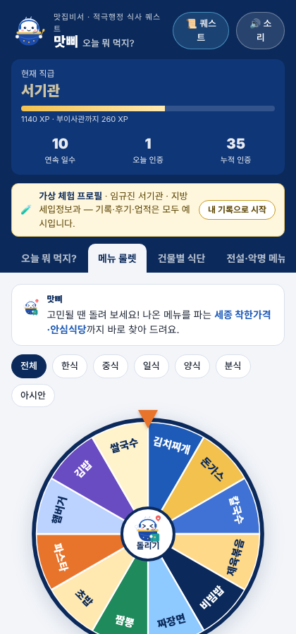
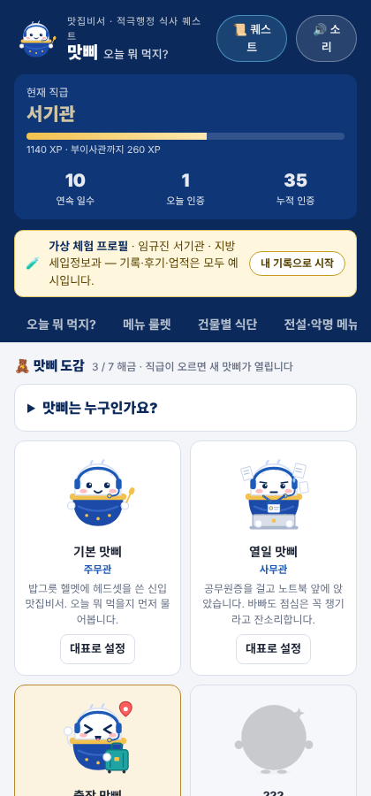

# 맛삐 · 오늘 뭐 먹지?

정부세종청사 공무원의 점심 결정을 돕는 맛집비서 **맛삐**입니다.
국민비서 '구삐'가 행정 정보를 먼저 챙겨 주듯, 맛삐는 흩어진 구내식당 식단과 공공데이터 3종을 한 화면에 모아 목적에 맞는 식사 장소와 메뉴를 추천합니다.

- **서비스 주소**: https://matppi.vercel.app
- **출품**: 2026년 「말하는 대로, 바이브 코딩 페스타」
- **만든 사람**: 행정안전부 지방세입정보과 임규진 서기관


## 해결하려는 문제

점심 한 끼를 정하는 일도 정보를 모으고, 목적에 맞게 판단하고, 결정하는 행정입니다. 그런데 필요한 정보가 흩어져 있습니다.

| 기존 방식 (확인할 곳 5곳) | 맛삐 (1곳) |
| --- | --- |
| 1. 구내식당 식단표 이미지 (건물마다 따로 게시) | 링크 하나, 한 화면 |
| 2. 행정안전부 착한가격업소 누리집 | 오늘 내 건물 식단 |
| 3. 농림축산식품부 안심식당 목록 | 인증 식당 3종 통합 |
| 4. 소상공인시장진흥공단 백년가게 목록 | 목적·입맛별 추천 |
| 5. 지도 앱 (위치·영업시간) | 출장 등록 한 번이면 출장지로 전환 |

※ 걸리는 시간이 아니라 확인해야 하는 곳의 수를 비교했습니다 (개발자 직접 확인, 2026.11).

공공데이터 3종을 합치는 과정에서 식당이 아닌 업소(사진관 등) 710곳이 섞여 있는 것을 확인해 걸러 냈습니다.

## 주요 기능

| 기능 | 설명 |
| --- | --- |
| 오늘 뭐 먹지? | 내 건물 구내식당 오늘 메뉴, 같은 메뉴 외식·색다른 메뉴 추천 |
| 목적별 추천 | 혼밥·밥터디·팀 점심·회식 상황에 맞는 식당 |
| 출장맛삐 2.0 | 스마트출장앱(인사혁신처)의 신청→예약→정산 4단계를 따라 출장 등록·식사 동선표·식비 미터·출장 맛 결산서 제공 |
| 내 입맛 · 구내식당 뽑기 | 좋아하는 음식·못 먹는 음식을 반영해 12개 구내식당 중 추첨 |
| 메뉴 룰렛 | 메뉴 추가·삭제, 종류별 돌리기, 나온 메뉴를 파는 세종 식당 찾기 |
| 전설·악명 메뉴 투표 | 8개월 식단 속 단골 메뉴 투표 |
| 퀘스트 · 직급 · 맛삐 도감 | 인증하면 경험치, 주무관부터 청백리까지 승진, 직급별 캐릭터 해금 |
| 맛삐 목소리 | 퀘스트·룰렛·승진·출장 등 29개 상황 음성 안내 |

| 오늘 뭐 먹지? | 메뉴 룰렛 | 맛삐 도감 |
| --- | --- | --- |
|  |  |  |

## 출장맛삐 2.0 — 스마트출장앱 연계

> 이동과 잠은 스마트출장앱이, 밥은 출장맛삐가.

인사혁신처 e-사람 스마트출장앱은 출장 신청부터 교통·숙박 예약, 정산, 디브레인 지출까지 한 번에 처리하지만 식사는 다루지 않습니다. 식비는 정액(1일 25,000원)이라 정산 대상도 아니어서, 출장지에서 어디서 먹을지는 여전히 각자 찾아야 합니다. 출장맛삐는 스마트출장앱과 같은 4단계로 이 빈칸을 채웁니다.

| 스마트출장앱 | 출장맛삐 2.0 |
| --- | --- |
| ① 출장신청서 작성 | 출장 등록: 같은 항목(출장종류·기간·여러 목적지·교통수단·도착역·숙소·인원), e-사람 출장 내역 붙여넣기 자동 인식 |
| ② 통합검색·교통·숙박 예약 | 식사 동선표: 도착·귀경 시각으로 끼니별 장소(세종·역 동네·출장지·숙소 근처)를 정하고 3곳씩 추천, 식비 미터 |
| ③ 정산 자동 반영 | 현지 인증, 출장 퀘스트(점검·감사 출장은 「청렴 한 끼」) |
| ④ 디브레인 지출 연계 | 출장 맛 결산서: 인증 끼니·이용 식당·동선표 실행률을 자동 집계, 결산 완료 보상 |

- 주요 KTX·SRT역, 고속버스터미널, 공항 45곳의 동(읍·면) 표를 만들어 "역 동네" 식당을 찾습니다. 좌표가 아니라 주소의 동 기준입니다.
- 식비 미터의 기준(1일 25,000원)은 인사혁신처 스마트출장 교육 매뉴얼에 적힌 여비 기준이며, 실제 지급은 소속 기관 기준을 따릅니다.
- 스마트출장앱과 데이터를 직접 주고받지는 않습니다(공개 연계 수단 없음). 바로가기와 같은 항목 구조, 붙여넣기 인식으로 다시 입력하는 수고를 줄입니다.

## 사용 방법

### 웹에서 바로 쓰기
휴대폰이나 PC 브라우저로 서비스 주소를 엽니다. 설치와 로그인은 필요 없습니다.

### 내 컴퓨터에서 실행하기 (Local)
데이터 파일을 불러오기 때문에 `index.html`을 더블클릭하지 말고, 간단한 웹 서버로 엽니다.

```bash
git clone https://github.com/mogaha3-ctrl/matppi.git
cd matppi
python -m http.server 8000
# 브라우저에서 http://localhost:8000 접속
```

- 필요 환경: Python 3 (웹 서버 용도), 최신 크롬·엣지·사파리
- 외부 서버나 API 키는 필요 없습니다.

## 폴더 구조

```
index.html   앱 전체 (화면·로직·캐릭터 그림 포함, 한 파일)
data.json    식당 데이터 (착한가격업소·백년가게·안심식당 통합, 10,713곳)
menu.json    중앙동 구내식당 식단 (이번 주 + 8개월 171일 기록)
oth.json     중앙동 외 11개 구내식당 참고 식단
voice/       맛삐 음성 안내 24개 (MP3)
docs/img/    README용 이미지
```

## 데이터 출처와 기준일

| 데이터 | 제공 기관 | 기준일 |
| --- | --- | --- |
| 착한가격업소 현황 | 행정안전부 (공공데이터포털) | 2026.9.30 |
| 전국 백년가게 지정 리스트 | 소상공인시장진흥공단 (공공데이터포털) | 2026.8.20 |
| 안심식당 (세종) | 농림축산식품부 지정, 세종 목록 | 2026.11.18 |
| 구내식당 식단 | [정부청사관리본부](https://www.gbmo.go.kr/chungsa/dv/dietView/selectDietCalendarView.do?mi=1277&gbd=CD002) 게시 식단표 | 2026.1~11 |

- 업소마다 인증이 겹칠 수 있어, 합친 업소 수는 각 데이터 수의 합과 다릅니다.
- 이번 주 식단이 아직 반영되지 않은 날에는 가장 최근 같은 요일 식단을 "참고"로 표시합니다.
- 메뉴 이름으로 못 먹는 음식을 경고하지만, 알레르기 정보는 아닙니다. 알레르기는 각 식당·영양사에게 확인하세요.

## 개인정보와 저장

- 로그인이 없고, 개인정보를 수집하지 않습니다.
- 경험치·인증 기록·입맛 설정·투표는 사용하는 브라우저(기기)에만 저장됩니다.
- 앱 안의 '임규진 서기관' 체험 프로필은 기능을 보여 주기 위한 가상 기록입니다.

## 다른 기관에 적용하기

맛삐의 방식(흩어진 공공데이터 모으기 → 목적에 맞게 추천 → 퀘스트로 참여)은 데이터 파일만 바꾸면 다른 곳에도 쓸 수 있습니다.

1. **다른 청사·지자체 구내식당**: `menu.json`, `oth.json`을 그 기관 식단으로 바꿉니다.
    - 서울·대전청사 구내식당 식단도 세종과 같은 [정부청사관리본부 식단 페이지](https://www.gbmo.go.kr/chungsa/dv/dietView/selectDietCalendarView.do?mi=1277&gbd=CD002)에 같은 형식으로 게시됩니다.
    - 외식 추천은 지금도 서울(착한가격업소·백년가게 1,545곳)과 대전(395곳)에서 작동하므로, 식단 파일만 추가하면 서울·대전청사에서 바로 쓸 수 있습니다.
2. **다른 지역 식당**: 공공데이터포털에서 받은 착한가격업소·백년가게·안심식당 파일을 `data.json` 형식으로 변환합니다.
3. **다른 업무**: 같은 구조로 민원 안내, 회의 장소 정하기, 출장 준비처럼 "여러 출처의 정보를 모아 목적별로 추천"하는 업무에 응용할 수 있습니다.

## 만든 방법

Claude와 대화하며 만든 바이브 코딩 결과물입니다. 화면은 HTML·CSS·JavaScript 한 파일이고, 별도 프레임워크나 서버가 없습니다.

## 라이선스와 출처

- 코드: MIT License
- 맛삐 캐릭터: 이 프로젝트를 위해 새로 그린 창작 캐릭터
- 음성: [Supertonic 3](https://huggingface.co/Supertone/supertonic-3) (Supertone Inc., 모델 OpenRAIL-M 라이선스, 코드 MIT)으로 생성한 음성 파일. 모델 자체는 이 저장소에 포함하지 않습니다.
- 공공데이터: 공공데이터포털 및 각 제공 기관의 이용 조건을 따릅니다.
